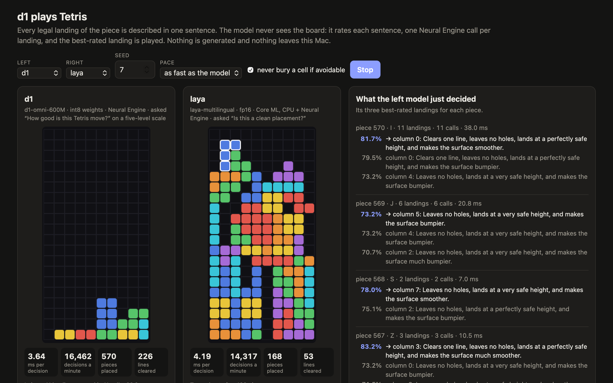

# d1-ane

[LiquidAI/d1-omni-600M](https://huggingface.co/LiquidAI/d1-omni-600M) running entirely on the Apple Neural Engine, and playing Tetris with it.

d1 is a decision model: a state (text, an image or speech) and a question go in, a probability for every option comes out of one forward pass, with no generated tokens. This repository converts it to Core AI packages that are placed fully on the Neural Engine, serves them, and benchmarks them. One short text decision takes 3.4 ms on an M4 Max.



## Quick start

You need an Apple Silicon Mac on macOS 27 (Core AI) and [uv](https://docs.astral.sh/uv/).

```sh
git clone https://github.com/nathanrchn/d1-ane && cd d1-ane
uv sync
uv run d1ane setup --laya     # once: downloads 3 GB, converts, compiles for your Neural Engine
uv run d1ane tetris           # then open http://127.0.0.1:8798/
```

`setup` downloads the checkpoint from Hugging Face (2.3 GB, LFM Open License v1.0), converts it and compiles it. After the download that takes about six minutes, most of it the Neural Engine compiler; later starts take under a second. `--laya` also fetches laya (650 MB), the model d1 plays against. If Hugging Face refuses the download, accept the licence on the model page and log in with `uv run hf auth login`.

## Tetris

Every legal landing of a piece is described in one sentence. The model never sees the board: it rates each sentence in one Neural Engine call, and the best-rated landing is played. The page runs two players on the same pieces, d1 on the left and laya, a hand-written heuristic or a random player on the right. It shows each side's time per decision and d1's three best-rated sentences for every piece.

The game harness is the one of [FluidUse](https://github.com/FluidInference/FluidUse)'s "laya plays Tetris" demo, ported to Python, and laya is their published Core ML package. Ten games each, seeds 1 to 10, capped at 5,000 pieces, on an M4 Max:

| | d1-omni-600M | laya |
| --- | ---: | ---: |
| Mean pieces placed | **3,048** | 568 |
| Mean lines cleared | **1,210** | 215 |
| Games that reached the 5,000-piece cap | 3 of 10 | 0 of 10 |
| Mean pieces placed, seeds 11 to 20 | **2,420** | 492 |
| Mean pieces placed without the harness filter | **600** | 92 |
| One decision inside the game | **3.6 ms** | 4.1 ms |
| Decisions per minute | **16,200** | 14,700 |

What these numbers do and do not show:

- **Each model plays with the wording and question tuned to it.** With laya's wording and question d1 places about 50 pieces; with d1's, laya places 154 at best. d1 does not know Tetris: it rates how good or bad a sentence sounds, and it rates "makes the stack taller" above "keeps the stack low". Its wording was chosen clause by clause from its own ratings, and it is asked "How good is this Tetris move?" on five levels instead of a yes or no.
- **The harness does the looking.** It computes the holes, heights and bumps that the sentence reports, and its filter withholds landings that bury a cell. The hand-written heuristic over the same features places 2,874 pieces, so d1 plays at the heuristic's level and picks the same landing 87% of the time.
- **Seeds.** d1's wording was chosen with games of seeds 1 to 10 in view, so seeds 11 to 20 are the cleaner comparison. The laya run on seeds 1 to 10 reproduces FluidUse's published 568.3 pieces.
- **Speed.** Both models were timed in turns on one Mac. laya runs through Python here; FluidUse reports 3.7 ms on an M5 Pro through their Swift runtime. d1 is the larger network (314M weights per call against laya's 125M) and gets ahead through 8-bit weights.

## Decisions

```sh
uv run d1ane serve            # http://127.0.0.1:8797/ has a page to try text and image questions
```

```sh
curl -s http://127.0.0.1:8797/v1/systemone -d '{
  "state": "I was charged twice this month, please refund one of them.",
  "questions": {
    "refund": {"type": "noul", "instructions": "Is the customer asking for a refund?"},
    "team": {"type": "choice", "instructions": "Which team should handle this?",
             "criteria": {"billing": "Charges, refunds, invoices", "technical": "App or site faults", "fraud": "Suspected unauthorised use"}}}}'
```

A question is `noul` (yes or no), `choice` (named options) or `score` (ordered levels). `images` takes a list of base64 strings or data URLs, `audio` one base64 16 kHz mono file. The response has `answers`, `usage` and `timings`. From Python:

```python
from d1ane.runtime import Decider

d = Decider("build/d1-omni-600M")       # compute="ane" (default) | "gpu" | "cpu" | "auto"
d.system_one("The disk is full.", {"next": {"type": "choice", "instructions": "What next?",
                                            "criteria": {"page": "Page someone", "wait": "Wait"}}})
```

## Results

One question, end to end, median of warm runs on an M4 Max:

| | Neural Engine | GPU (Core AI) | PyTorch MPS fp16 |
| --- | ---: | ---: | ---: |
| Text, up to 64 tokens | **3.4 ms** | 10.9 ms | 16.0 ms |
| Text, 256 tokens | **15.5 ms** | 25.4 ms | 30.0 ms |
| Text, 512 tokens | 46.4 ms | 45.4 ms | 55.1 ms |
| Text, 2,048 tokens | 333 ms | **193 ms** | 262 ms |
| Image, 224×224 | **17.2 ms** | 28.7 ms | 55.4 ms |
| Image, 640×480 | 92.2 ms | 80.2 ms | **72.8 ms** |
| Audio, 2 s | **11.6 ms** | 26.8 ms | 40.6 ms |
| Audio, 10 s | **20.5 ms** | 33.7 ms | 47.4 ms |
| Audio, 30 s | 93.8 ms | **70.3 ms** | 80.2 ms |

Accuracy against the checkpoint in PyTorch FP32:

| | Default build (int8 weights) | FP16 build | PyTorch FP32 | int8 answers that differ from FP32 |
| --- | ---: | ---: | ---: | ---: |
| Text: 2,600 fast-decisions questions | 75.23% | 75.31% | 75.19% | 23 (0.88%) |
| Images: 600 POPE yes/no questions | 83.50% | 83.83% | 83.83% | 2 (0.33%) |
| Audio: 763 spoken intents | 36.83% | 36.83% | 36.96% | 15 (1.97%) |

- **Placement:** all 22 entries of the three packages (trunk and head, vision tower, audio encoder) are fully on the Neural Engine.
- **int8 weights:** the default build stores the trunk and head weights in 8 bits. That halves the package (327 MB against 640 MB) and makes prompts of up to 64 tokens 1.7 times faster (3.4 ms against 5.9 ms); longer prompts take about the same time. `d1ane setup --quant fp16` builds the FP16 reference. The first row of the first table is the int8 build; the other rows were measured on the FP16 build.
- **Long inputs:** the Neural Engine wins up to about 384 positions and loses beyond; `--compute auto` moves the long entries to the GPU.
- **The audio score:** 563 of the 763 clips are 8 kHz telephone banking speech, which every engine gets about 21% right (the other 200: 82 to 83%). They are there to compare engines, not as a claim about quality.

Full tables, method and caveats are in [RESULTS.md](RESULTS.md). The machine was not idle; this is not a controlled benchmark.

## How it works

```
state, question ──► prompt.py (the checkpoint's own) ──► token ids, option-marker positions
                                                              │ host: embedding lookup, masks
images ─► tile + patchify (host) ─► vision.aimodel (ANE) ─┐   ▼
audio  ─► log-mel (host)         ─► audio.aimodel  (ANE) ─┴► stage0_L00-15_head.aimodel (ANE)
                                     prefix embeddings        16 trunk layers ─► final norm ─► head ─► scorer
                                                              │ scores at every position
                                                              ▼ host: read the markers, temperature, softmax
                                                           answers
```

- **One fixed-shape call per question.** d1 is a bidirectional encoder, so there is no cache and no decoding loop. Each package holds one copy of the weights and one entry per sequence width; a decision runs in the narrowest width that holds it.
- **Media are a prefix.** Images and audio are encoded into embeddings that go in front of the question in the same trunk.
- **Graphs shaped for the Neural Engine.** Activations are `(1, C, 1, T)` in FP16 with 1×1 convolutions. The norms divide by the largest magnitude before squaring, because the plain form overflows FP16. SiLU and GELU are written out, because the Neural Engine's own versions are too coarse (RESULTS.md, design checks).
- **Placement is audited, not assumed.** `d1ane compile` reads the specialization cache and reports whether every entry is fully on the Neural Engine.

The method follows [Anemll/system1-ane](https://github.com/Anemll/system1-ane), which did the same for a Qwen-based decision model.

## Repository

| Path | What |
| --- | --- |
| `d1ane/cli.py` | the `d1ane` command: `setup`, `tetris`, `serve`, and the single steps |
| `d1ane/graph.py` | trunk and head graphs in Neural Engine layout |
| `d1ane/convert.py`, `vision.py`, `audio.py` | export to Core AI packages (and the media runtimes) |
| `d1ane/compile.py`, `placement.py` | Neural Engine specialization and the placement audit |
| `d1ane/runtime.py` | `Decider`: the Core AI backend (ANE, GPU, CPU, auto) and a PyTorch backend of the same graph |
| `d1ane/serve.py`, `demo.html` | `POST /v1/systemone`, `/health`, and the page |
| `d1ane/tetris.py`, `play.py`, `tetris.html` | the Tetris harness, the game server and its page |
| `d1ane/laya.py` | the laya baseline: FluidUse's Core ML package through coremltools |
| `bench/` | the benchmarks behind RESULTS.md |
| `tests/` | unit tests and Neural Engine parity checks |

## Benchmarks and checks

```sh
uv sync --extra bench                                               # adds transformers and datasets
uv run python -m unittest discover -s tests                         # no Neural Engine needed
uv run python tests/ane_smoke.py --model models/d1-omni-600M --build build/d1-omni-600M    # ANE against PyTorch FP32

uv run d1ane setup --quant fp16 --build build/d1-omni-600M-fp16     # the FP16 reference build
bench/all.sh && uv run python bench/report.py > RESULTS.md          # every benchmark, one engine at a time
uv run python bench/tetris.py --policy d1 --shortlist --seeds 1-10  # ten Tetris games, a JSON line each
```

## Limits

- Measured on one chip, an M4 Max. system1-ane found that M5 needs `MPSGRAPH_ANE_BONDED_COMPILE_MODE=1` and M6 uses 2; this tree leaves the mode at the system default and honours the variable if you set it.
- The widest entry is 2,048 positions (the checkpoint allows 16,384). Longer states are truncated on the right.
- One question is one forward: a request with three questions costs three calls.
- Tiled images are slow on the Neural Engine: one tower call per crop.
- Tetris shows decision speed, not game sense: the harness extracts the features and writes the sentence, and the wording was tuned to each model.
- The comparisons are GPU engines only (Core AI and PyTorch MPS); the CPU and power draw were not measured.
- If every Neural Engine load fails with `_GenericObjCError error 0`, the system has dropped its compiled programs: run `uv run d1ane compile --force`.

## Credits

- [LiquidAI/d1-omni-600M](https://huggingface.co/LiquidAI/d1-omni-600M), under the LFM Open License v1.0. No weights are in this repository; `setup` copies the checkpoint's prompt code, tokenizer and licence into the build.
- [Anemll/system1-ane](https://github.com/Anemll/system1-ane) (MIT), for the method.
- [FluidInference/FluidUse](https://github.com/FluidInference/FluidUse) (Apache-2.0): `d1ane/tetris.py` is a port of its Tetris harness, and the baseline is its Core ML conversion of [laya](https://github.com/NandhaKishorM/laya) by Convai Innovations (Apache-2.0).
